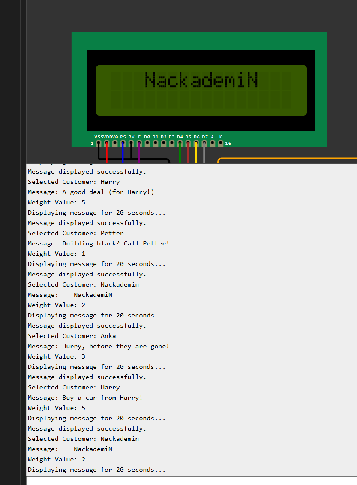

# **Customer Message Display on LCD**

This project dynamically displays customer messages on an LCD screen based on their payment weight. The messages are selected randomly but weighted by the customer's payment. Additionally, no message is displayed twice consecutively. The output is also logged on the UART terminal for monitoring.

## 
   

## **Features**

1. **Dynamic Customer Selection**:

   - Customers are selected based on their payment weight.
   - Higher payments increase the probability of being selected.

2. **Message Rotation**:

   - Each customer's messages are displayed in a weighted random order.
   - Ensures no message is repeated consecutively.

3. **Fixed Message Duration**:

   - Each message is displayed on the LCD for 20 seconds.

4. **UART Debugging**:
   - Logs the selected customer, message, and message weight on the serial terminal.

---

## **Components**

### **Hardware Requirements**

- **Microcontroller**: AVR (e.g., ATmega328P).
- **LCD Module**: HD44780-compatible 16x2 display.
- **UART Interface**: For debugging via serial terminal.

### **Software Requirements**

- **Toolchain**: AVR-GCC.
- **UART Terminal**: e.g., PuTTY, Tera Term, or Arduino Serial Monitor.

---

## **Customers and Messages**

### **Customer List**

| Customer   | Payment (Weight) | Messages                       |
| ---------- | ---------------- | ------------------------------ |
| Harry      | 5000 (5)         | "Buy a car from Harry!"        |
|            |                  | "A good deal (for Harry!)"     |
|            |                  | "Honest Harry's Cars"          |
| Anka       | 3000 (3)         | "Buy pies from Anka!"          |
|            |                  | "Hurry, before they are gone!" |
| Petter     | 1500 (1.5)       | "Let Petter build for you!"    |
|            |                  | "Building black? Call Petter!" |
| Nackademin | 2000 (2)         | "NackademiN"                   |

---

## **How It Works**

1. **Initialization**:
   - The LCD and UART are initialized at the start of the program.
2. **First Round**:
   - Displays all messages from each customer sequentially, ensuring every message is seen at least once.
3. **Dynamic Selection**:
   - Customers are selected randomly, weighted by their payment amount.
   - A random message is chosen for the selected customer, avoiding consecutive repetition.
4. **Message Display**:
   - Each message is displayed on the LCD for 20 seconds.
   - Logs are sent to the UART terminal.

---

## **Serial Output Example**

The following is an example of UART debugging output:

## **How to Run the Code on Wokwi Simulator**

1. **Open the Wokwi Project**:

   - Click on the following link to open the simulator: [Wokwi Project](https://wokwi.com/projects/416241646559459329).

2. **View the Circuit Diagram**:

   - The project contains the microcontroller, LCD, and UART interface connected.

3. **Run the Simulation**:

   - Click the green "Start Simulation" button in the Wokwi interface.

4. **Monitor the UART Output**:

   - Open the "Serial Monitor" in the Wokwi simulator to view the debug output, including selected customer, message, and weights.

5. **Stop the Simulation**:
   - When done, click the "Stop Simulation" button.

